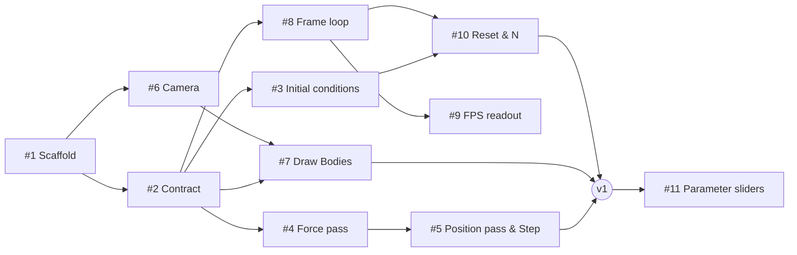

# Issue plan

Guides for building the n-body simulation step by step. Each issue says *what* to build and *what to watch out for*, never *how* in code. Vocabulary follows [`GLOSSARY.md`](../../GLOSSARY.md).

## Working agreement

- No fixed component ownership: whoever is free picks the next unblocked issue.
- One branch and one PR per issue; at least one review by one of the other two before merging to `main`.
- Touch the data contract (#2) as little as possible; if it must change, discuss it with everyone first.

## Phases

**Phase 0: all three together**
- #1 Scaffold & GPU device
- #2 Data contract

**Phase 1: three parallel tracks (suggested, not owned)**

| Track | Issues |
|---|---|
| Simulation | #3 Initial conditions → #4 Force pass → #5 Position pass & Step |
| Renderer | #6 Fixed camera → #7 Draw Bodies |
| Loop / UI | #8 Frame loop → #9 FPS readout → #10 Reset & N input |

🎯 **Milestone v1 "it runs"**: #5, #7 and #10 merged and working together.

**Phase 2: later**
- #11 Parameter sliders

## Dependencies

## Labels and milestones

- Labels: `setup` (#1, #2), `simulation`, `renderer`, `ui`
- Milestones: `v1` (#1–#10), `later` (#11)

## General resources

- [WebGPU Fundamentals](https://webgpufundamentals.org/): the best tutorial series; most hints link here
- [MDN: WebGPU API](https://developer.mozilla.org/en-US/docs/Web/API/WebGPU_API)
- [WebGPU spec](https://www.w3.org/TR/webgpu/) and [WGSL spec](https://www.w3.org/TR/WGSL/)
